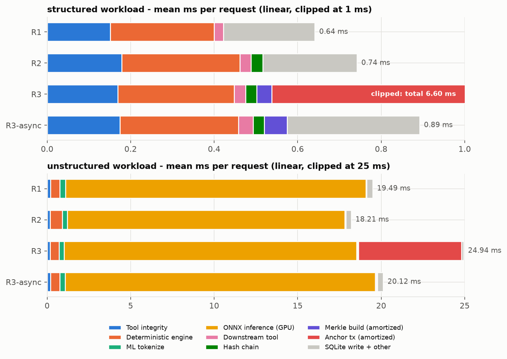
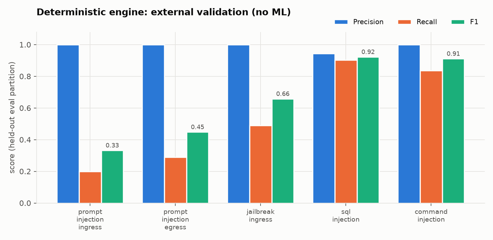

# OmniGuard-MCP

**A tamper-evident security gateway and deterministic information-flow firewall for Model Context Protocol (MCP) agent systems.**

OmniGuard-MCP sits between an AI agent and the MCP tool servers it calls. It checks every tool definition against a pinned SHA-256 digest. Every `tools/call` passes through attribute-based access control and a five-stage deterministic inspection engine, in both directions. Every decision goes into an audit log that can be hash-chained, Merkle-batched and anchored on an EVM chain, and an independent watcher process verifies that log from outside the gateway.

**No machine learning model is trained, loaded or executed anywhere in this repository.** Every decision is a weighted sum of named, deterministic rules. The same input in the same session state always produces the same decision, risk score, rule list and `canonical_input_hash`.

> **Scope and limitation.** Canonicalization, structural parsers and cross-tool taint tracking close the encoding, injection and multi-step exfiltration vectors described in [docs/THREAT_MODEL.md](docs/THREAT_MODEL.md). Deterministic signatures **cannot reliably detect novel or paraphrased (semantic) prompt injection**. The external evaluation below measures this: precision is 1.0 but recall on prompt injection is 0.20-0.49. OmniGuard does not claim comprehensive semantic threat detection. For that class it relies on containment: taint-based egress blocking and ABAC limit what a successfully injected agent can do.

---

## Architecture

```
        AI agent (MCP client)
              |  JSON-RPC over stdio or HTTP  (bearer token)
              v
 +--------------------------------------------------------------+
 | Agent 1  gateway_agent.py   security gateway & IFC firewall  |
 |  1 identity + session   2 tool SHA-256 integrity   3 ABAC     |
 |  4 ingress engine  ->  5 downstream call + taint update       |
 |  6 egress engine / DLP (ALLOW | REDACT | DENY)   7 audit      |
 +-------------------+---------------------------+--------------+
                     |                           | JSON-RPC
                     v                           v
 +---------------------------------+   +------------------------------+
 | Agent 2  audit_anchor_agent.py  |   | sample_mcp_server.py         |
 |  R1 plain | R2 hash chain |      |   | 10 tools, all side effects   |
 |  R3 chain + Merkle(B=16) +       |   | simulated (no real shell,    |
 |     anchorBatch() on-chain       |   | network or email)            |
 +---------------+-----------------+   +------------------------------+
                 | tx                                   ^ live tools/list
                 v                                      |
        AuditAnchor.sol (write-once) <--- own RPC ---+  |
                                                     |  |
 +---------------------------------------------------+--+------------+
 | Agent 3  watcher_agent.py - separate OS process, SQLite mode=ro,  |
 | own RPC client, own manifest snapshot -> TamperAlert JSON         |
 +-------------------------------------------------------------------+
```

### The deterministic engine (`omniguard/security/`)

| Stage | Module | What it does |
|---|---|---|
| 1 Canonicalize | `canonicalizer.py` | NFKC, zero-width stripping, then iterative URL / HTML-entity / `\x` / Base64 / hex decoding to a fixed point (bounded depth). Embedded Base64 tokens become extra views. |
| 2 Structural analyzers | `analyzers.py` | **PathJail** (posix normalisation, workspace containment), **SSRFValidator** (`urllib.parse` + `ipaddress`, including decimal, hex, octal and IPv4-mapped forms, metadata IP, unsafe schemes), **ShellAnalyzer** (quote-aware scanner + `shlex`), **SQLAnalyzer** (lexer; stacked, UNION, tautology, time-based, catalog and dangerous-function checks, plus libinjection-style quote-breakout contexts for fragments), compiled threat signatures. |
| 3 Taint tracking | `taint_tracker.py` | Per-session monotone labels `CLEAN` / `TAINTED_UNTRUSTED` / `TAINTED_SENSITIVE`. Sensitive sessions can never call `http_post`, `send_email` or `webhook_emit`. Untrusted sessions get a 1.5x injection-sensitivity multiplier and no shell. |
| 4 Bidirectional inspection + DLP | `security_engine.py` | Ingress and egress signatures. Prefixed secrets (`AKIA`, `ghp_`, `sk-`, PEM, JWT, ...) gated by Shannon entropy. `REDACT` masks secrets in place. |
| 5 Scoring + trace | `security_engine.py` | `risk = sum(max weight per distinct rule) x taint multiplier`, DENY at 1.0. Emits `decision`, `risk_score`, `triggered_rules`, `taint_state`, `canonical_input_hash`. |
| ABAC | `abac.py` + `configs/abac_policies.yaml` | Deny-by-default role -> tool -> parameter constraints, e.g. `analyst` may call `query_db` only with `SELECT`, `LIMIT <= 100`, tables prefixed `analytics_`/`public_`; `operator` paths only under `/workspace/**`, allowlisted shell binaries and email domains. |
| Tool pinning | `tool_integrity.py` + `configs/pinned_tools.json` | `SHA256(canonical_json({name, description, inputSchema}))`. Tampered tools are stripped from `tools/list` and refused on `tools/call`. |

### Audit regimes (`omniguard/storage/audit_store.py`, `agents/audit_anchor_agent.py`)

* **R1**: conventional table, no integrity metadata.
* **R2**: append-only hash chain, `entry_hash = SHA256(seq_num || prev_hash || canonical_payload)`. The payload is rebuilt from the row's columns, so editing any column is detectable.
* **R3**: R2 plus a binary SHA-256 Merkle tree every B=16 records (RFC 6962 leaf/node domain separation, no odd-leaf duplication), per-record inclusion proofs, and `anchorBatch(batchId, root, startSeq, endSeq)` on [`contracts/AuditAnchor.sol`](contracts/AuditAnchor.sol). The contract enforces in-order, gap-free, write-once anchors. Anchoring is synchronous by default; `--async-anchor` submits transactions from a background worker.

---

## Quick start

```powershell
python -m venv .venv
.\.venv\Scripts\python -m pip install -e . pytest
```

On Windows without a C compiler, install `eth-tester` **without** the `[py-evm]` extra. That extra pulls in `safe-pysha3`, which must be compiled; `py-evm` is installed directly instead, and `eth-hash` falls back to pycryptodome. The Solidity compiler (solc 0.8.24) is downloaded by `py-solc-x` on first use, and the compiled artifact is cached in `contracts/build/`.

### Run the tests

```powershell
.\.venv\Scripts\python -m pytest -v
```

### Run every experiment

```powershell
.\.venv\Scripts\python scripts\run_all_experiments.py
```

This needs internet access for the Hugging Face streams; if the hub is unreachable, those streams are marked unavailable and a small sanity check runs instead. Outputs go to `results/`: three JSON + Markdown reports, five PNG figures and `SUMMARY.md`. Options: `--max-samples`, `--trials`, `--requests`, `--batch-size`, `--plots-only`.

### Run the system yourself

The four identities in `configs/abac_policies.yaml` are **local development test identities** whose bearer tokens are `dev-token-<role>`. Only their SHA-256 hashes are stored in the config; replace them before any real use.

1. Start a local EVM node (eth-tester over JSON-RPC, a separate process):

   ```powershell
   .\.venv\Scripts\python -m omniguard.crypto.chain_node --port 8545
   ```

2. Start the gateway (R3, HTTP transport, stdio downstream server). It deploys `AuditAnchor` and writes `results/runtime/deployment.json`:

   ```powershell
   .\.venv\Scripts\python -m omniguard.agents.gateway_agent --transport http --port 8765 --regime R3 --rpc-url http://127.0.0.1:8545
   ```

   Then `POST /mcp` with `Authorization: Bearer dev-token-operator` and an MCP JSON-RPC body. `GET /verify/<seq>` returns a record's Merkle proof and on-chain anchor receipt. Use `--transport stdio` (token taken from `OMNIGUARD_TOKEN`) to plug the gateway directly into an MCP client.

3. Sweep the log with the independent watcher (one-shot, or `--interval 30` for continuous):

   ```powershell
   .\.venv\Scripts\python -m omniguard.agents.watcher_agent --db results/runtime/gateway_audit.db --regime R3 --deployment results/runtime/deployment.json --manifest-snapshot configs/pinned_tools.json --live-sample-server --json
   ```

   Exit code 0 means clean; 2 means at least one `TamperAlert` (printed to stderr and emitted as JSON).

---

## Results

All numbers below come from one run of `scripts/run_all_experiments.py` (Windows 11, Python 3.13, total 3.7 min). Full tables are in [`results/`](results/SUMMARY.md).

### A. External dataset validation: deterministic engine detection metrics

Samples are streamed from Hugging Face (`streaming=True`) and wrapped at evaluation time into MCP `tools/call` envelopes (ingress) or `web_fetch` result envelopes (egress). A positive prediction is an engine `DENY`; ABAC is excluded.

**Protocol:** rows are split by `sha256(text) % 5` into a 20% **dev** partition, which was the only data inspected while writing rules, and an 80% **eval** partition. The table reports a seeded reservoir sample of up to 500 eval rows per stream.

| Stream | Dataset | n | Precision | Recall | F1 | FPR | FNR | Mean ms |
|---|---|---|---|---|---|---|---|---|
| prompt injection, ingress | deepset/prompt-injections | 500 | 1.000 | 0.199 | 0.332 | 0.000 | 0.801 | 0.23 |
| prompt injection, egress (indirect) | deepset/prompt-injections | 500 | 1.000 | 0.289 | 0.448 | 0.000 | 0.711 | 0.18 |
| jailbreak, ingress | jackhhao/jailbreak-classification | 500 | 1.000 | 0.490 | 0.657 | 0.000 | 0.510 | 1.38 |
| SQL injection | zrmarine/sql_injection | 500 | 0.943 | 0.902 | 0.922 | 0.032 | 0.098 | 0.21 |
| command injection | AmirAliGharesoufloo/CommandInjection | 500 | 1.000 | 0.836 | 0.911 | 0.000 | 0.164 | 0.08 |

How to read this:

* **Structural payloads** (SQL, shell) are caught well: F1 ≈ 0.91-0.92.
* **Prompt injection:** the engine never cried wolf (0 false positives in 1,500 PI/jailbreak samples), but it misses most paraphrased injections. This is the documented limitation; `results/external_dataset_eval.md` lists real misses.
* **Dev vs eval drop:** prompt-injection ingress recall was 0.36 on the dev partition and 0.20 on held-out eval. This is evidence that signature rules overfit to the phrasings they were written from, which is why the held-out split matters.
* **Where SQL false positives come from:** `DELETE` and stacked statements that the dataset labels benign but a read-only analytics tool should refuse.

### B. Experiment 1: tamper detection (R1 vs R2 vs R3)

108 audit records per regime (96 requests plus taint events), 5 randomised trials per scenario. Every sweep is a fresh watcher OS process. S6a is caught by the gateway itself.

| ID | Scenario | R1 | R2 | R3 |
|---|---|---|---|---|
| S1 | Field modification (DENY→ALLOW, rules scrubbed) | No | **Yes** | **Yes** |
| S2 | Interior record deletion | Yes¹ | **Yes** | **Yes** |
| S3 | Tail truncation / rollback of latest batch | No | No | **Yes** |
| S4 | Record reordering / payload swap | No | **Yes** | **Yes** |
| S5 | Merkle root forgery (chain + local roots recomputed) | No | No | **Yes** |
| S6a | Tool rug-pull, pins intact | Yes² | Yes² | Yes² |
| S6b | Tool rug-pull + insider rewrites gateway pins | No | No | **Yes** |
| | **Trials detected** | 10/35 (28.6%) | 20/35 (57.1%) | **35/35 (100%)** |

¹ Via the autoincrement id gap; an attacker who renumbers ids would evade it. ² Gateway SHA-256 pin check, which is the same in all regimes.

There were zero false alarms on untampered logs.

Sweep cost on the clean 108-record log, measured inside the watcher:

| Regime | Check | Time |
|---|---|---|
| R1 | id continuity | 0.6 ms |
| R2 | hash chain | 3.8 ms |
| R3 | hash chain | 3.7 ms |
| R3 | Merkle roots | 0.4 ms |
| R3 | on-chain anchors (about 17 JSON-RPC reads) | 483 ms |
| R3 | manifest drift, including spawning a fresh downstream server for the live check | 2.1 s |

The detection mechanisms per scenario are listed in [`results/tamper_detection_r1_r2_r3.md`](results/tamper_detection_r1_r2_r3.md).

### C. Experiment 2: latency and storage (M = 500 requests, B = 16)

| Regime | Mean ms | p50 | p95 | p99 | Bytes / event | Anchor txs | Gas / event |
|---|---|---|---|---|---|---|---|
| R1 | 0.511 | 0.475 | 0.721 | 0.892 | 357 | 0 | 0 |
| R2 | 0.477 | 0.494 | 0.712 | 0.854 | 500 | 0 | 0 |
| R3 (sync anchoring) | 8.037 | 0.541 | 94.44 | 138.19 | 945 | 33 | 6,542 |
| R3-async | 0.631 | 0.547 | 1.269 | 1.993 | 945 | 33 | 6,542 |


* **Security pipeline cost.** Tool integrity plus the security engine cost about 0.3 ms per request. R1 and R2 differ by less than run-to-run noise (R2 came out slightly *faster* in this run), so the hash chain costs about 0.02 ms per event.
* **R3 anchoring.** A Merkle build costs about 0.5 ms per batch. An anchor transaction costs about 117 ms per batch on the py-evm dev chain over HTTP. With synchronous anchoring, every 16th request pays that cost, so R3's p95/p99 latency is dominated by anchoring. Moving the transaction to a background worker (R3-async) keeps p99 under 2 ms with identical detection guarantees for anchored batches; the trade-off is a longer unanchored window (see the threat model).
* **Storage.** R3 stores 2.6x R1's bytes per event (hash chain plus 390 B of Merkle proofs per record). On-chain cost is about 102k gas per batch, or 6.5k gas per audit event, with 132 bytes of calldata per batch.





---

## Repository layout

```
configs/      abac_policies.yaml, security_rules.yaml (weights + signatures), pinned_tools.json
contracts/    AuditAnchor.sol (+ build/ cache)
omniguard/
  crypto/     hashing.py, merkle.py, blockchain.py, chain_node.py (eth-tester JSON-RPC node)
  security/   canonicalizer.py, analyzers.py, taint_tracker.py, abac.py, tool_integrity.py, security_engine.py
  storage/    audit_store.py (R1/R2/R3 schemas, read-only access)
  agents/     gateway_agent.py, audit_anchor_agent.py, watcher_agent.py
  tools/      sample_mcp_server.py (reference MCP server; all side effects simulated)
  evaluation/ external_dataset_eval.py, tamper_experiments.py, perf_benchmark.py, workload.py
scripts/      run_all_experiments.py
tests/        7 test modules, 150 tests
docs/         THREAT_MODEL.md
results/      generated reports and figures
```

Regenerate the tool pins after changing the reference server with `python -m omniguard.security.tool_integrity --pin`.

## Notes on reproducibility

* Every experiment is seeded: the workload, tamper targets and reservoir sampling.
* The Hugging Face datasets can change upstream. Each report records rows streamed per partition.
* The chain is an in-memory development chain, so anchors live as long as the node process. See the threat model for what a production anchor needs.
