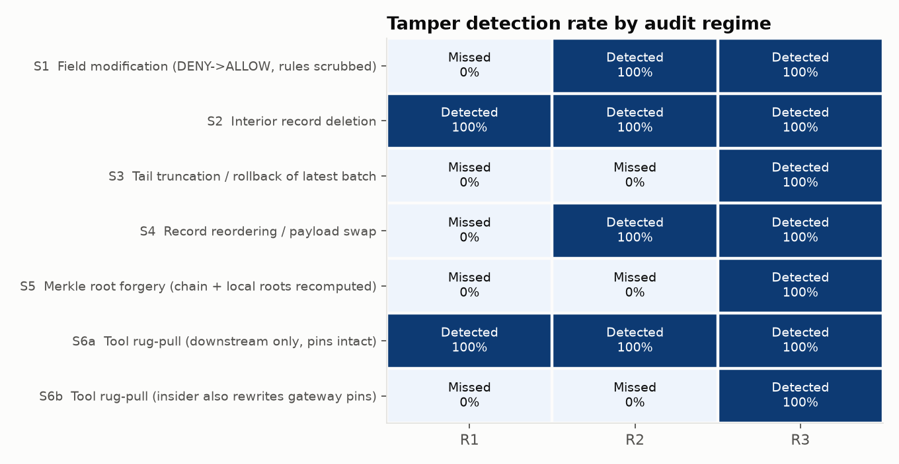

# OmniGuard-MCP

**A tamper-evident security gateway and hybrid (deterministic + integrity-pinned ML) information-flow firewall for Model Context Protocol (MCP) agent systems.**

OmniGuard-MCP sits between an AI agent and the MCP tool servers it calls. It checks every tool definition against a pinned SHA-256 digest. Every `tools/call` passes through attribute-based access control and a five-stage inspection engine, in both directions. Every decision goes into an audit log that can be hash-chained, Merkle-batched and anchored on an EVM chain. An independent watcher process verifies that log, the tool manifest and the deployed ML model from outside the gateway.

**Two engines, one pipeline.**

* **Deterministic fast path:** canonicalization, structural parsers, taint tracking, entropy DLP and ABAC. Runs on every request, sub-millisecond, fully explainable.
* **Hybrid ML stage:** only free-text prose that has *already passed* every deterministic check is also scored by an ONNX prompt-injection classifier on the GPU. The weights are fixed, SHA-256-pinned and verified in memory before they're loaded. Nothing is trained, and no generative model or LLM judge is used. The model can only add a DENY; it can never allow something the rules denied.

`v1.0-deterministic-baseline` (git tag) is the deterministic-only version; v1.1 adds the hybrid stage.

> **Scope and limitation.** Canonicalization, structural parsers and cross-tool taint tracking close the encoding, injection and multi-step exfiltration vectors described in [docs/THREAT_MODEL.md](docs/THREAT_MODEL.md). The hybrid classifier roughly **doubles** held-out prompt-injection recall over signatures alone, but recall is still **0.40-0.48**. Semantic prompt injection is narrowed, not solved. For that residual class, OmniGuard relies on containment: taint-based egress blocking and ABAC limit what a successfully injected agent can do.

---

## Architecture

```
        AI agent (MCP client)
              |  JSON-RPC over stdio or HTTP  (bearer token)
              v
 +-------------------------------------------------------------------+
 | Agent 1  gateway_agent.py   security gateway & IFC firewall       |
 |  1 identity + session   2 tool SHA-256 integrity   3 ABAC          |
 |  4 ingress:  deterministic engine ──pass + prose──> ONNX (CUDA)    |
 |  5 downstream call + taint update                                  |
 |  6 egress:   deterministic engine / DLP ──text output──> ONNX      |
 |  7 audit (decision, rules, taint, inspection_path, ml_score_milli, |
 |           ml_provider, model_sha16)                                |
 +---------------------+---------------------------+-----------------+
                       |                           | JSON-RPC
                       v                           v
 +---------------------------------+   +------------------------------+
 | Agent 2  audit_anchor_agent.py  |   | sample_mcp_server.py         |
 |  R1 plain | R2 hash chain |      |   | 10 tools, all side effects   |
 |  R3 chain + Merkle(B=16) +       |   | simulated (no real shell,    |
 |     anchorBatch() on-chain       |   | network or email)            |
 +---------------+-----------------+   +------------------------------+
                 | tx                                   ^ live tools/list
                 v                                      |
        AuditAnchor.sol (write-once) <--- own RPC ---+  |
                                                     |  |   models/ (pinned ONNX + tokenizer)
 +---------------------------------------------------+--+------------+---+
 | Agent 3  watcher_agent.py - separate OS process, SQLite mode=ro,       |
 | own RPC client, own tool + model manifest snapshots -> TamperAlert     |
 +------------------------------------------------------------------------+
```

### Inspection engine (`omniguard/security/`)

| Stage | Module | What it does |
|---|---|---|
| 1 Canonicalize | `canonicalizer.py` | NFKC, zero-width stripping, then iterative URL / HTML-entity / `\x` / Base64 / hex decoding to a fixed point (bounded depth). Embedded Base64 tokens become extra views. |
| 2 Structural analyzers | `analyzers.py` | **PathJail**, **SSRFValidator** (`ipaddress`, including decimal, hex, octal and IPv4-mapped forms, metadata IP, unsafe schemes), **ShellAnalyzer** (quote-aware + `shlex`), **SQLAnalyzer** (lexer + libinjection-style quote-breakout contexts), compiled threat signatures. |
| 3 Taint tracking | `taint_tracker.py` | Monotone per-session labels. `TAINTED_SENSITIVE` sessions can't use outbound tools. `TAINTED_UNTRUSTED` sessions get a 1.5x signature multiplier, **a lower ML threshold**, and no shell. |
| 4 Bidirectional inspection + DLP | `security_engine.py` | Ingress and egress signatures. Prefixed secrets gated by Shannon entropy. `REDACT` masks secrets in place. |
| 4b **Hybrid ML** | `ml_classifier.py` | `protectai/deberta-v3-base-prompt-injection-v2` (Apache-2.0, ONNX, revision `90c9989`). `CUDAExecutionProvider` with automatic CPU fallback. Up to four overlapping 512-token windows (max score). Score quantized to integer `ml_score_milli` (0-1000) before the integer-threshold comparison. |
| 5 Scoring + trace | `security_engine.py` | `risk = sum(max weight per distinct rule) x taint multiplier`, DENY at 1.0, plus `ML_PROMPT_INJECTION`. Emits `decision`, `risk_score`, `triggered_rules`, `taint_state`, `canonical_input_hash`, `inspection_path`, `ml_score_milli`. |
| ABAC | `abac.py` | Deny-by-default role -> tool -> parameter constraints (e.g. `analyst`: `SELECT` only, `LIMIT <= 100`, allowlisted table prefixes). |
| Tool pinning | `tool_integrity.py` | `SHA256(canonical_json({name, description, inputSchema}))`, plus each tool's `taint_class`, `arg_types` and `output_type`. |

**Routing rule for the hybrid stage.** A payload is scored by the model only if:

* every deterministic check passed;
* it is an argument of type `text`, or the output of a tool whose pinned `output_type` is `text` (`read_file`, `web_fetch`);
* it is longer than 40 characters;
* it is prose.

JSON is parsed and only its long prose string values are scored. Config-shaped text (`key=value` lines, as in `.env` files) stays deterministic, because the model scores such files at 990-1000 regardless of content. SQL, shell, paths, URLs and structured outputs are never routed, which is what keeps the fast path fast.

**Model integrity.** `configs/model_manifest.json` pins the SHA-256 of `model.onnx` (it matches the Hub's own LFS digest) and of `tokenizer.json`. Both files are read into memory, compared with `hmac.compare_digest`, and only then is `InferenceSession` built *from those verified bytes*. If either file doesn't match, the gateway refuses to start. The watcher re-hashes the deployed files against its own snapshot, and also checks that every hybrid audit record's `model_sha16` matches the pin.

### Audit regimes

* **R1**: conventional table.
* **R2**: SHA-256 hash chain, `entry_hash = SHA256(seq || prev_hash || canonical_payload)`. The payload, including the four ML fields, is rebuilt from the columns.
* **R3**: R2 plus a Merkle tree every B=16 records, inclusion proofs, and `anchorBatch()` on [`contracts/AuditAnchor.sol`](contracts/AuditAnchor.sol), which is in-order, gap-free and write-once. Anchoring is synchronous by default; `--async-anchor` submits from a background worker.

---

## Quick start

```powershell
python -m venv .venv
.\.venv\Scripts\python -m pip install -e . pytest
.\.venv\Scripts\python scripts\fetch_model.py
```

`fetch_model.py` downloads `onnx/model.onnx` (739 MB) and `onnx/tokenizer.json` at the pinned revision into `models/` (git-ignored) and verifies them against the manifest. `onnxruntime-gpu[cuda,cudnn]` brings its own CUDA 12 / cuDNN 9 runtime wheels, so no system CUDA toolkit is needed, only an NVIDIA driver. Without a GPU the classifier falls back to CPU, and without the model files the gateway runs deterministic-only.

On Windows without a C compiler, install `eth-tester` **without** the `[py-evm]` extra. That extra pulls in `safe-pysha3`, which must be compiled.

```powershell
.\.venv\Scripts\python -m pytest -v
```

```powershell
.\.venv\Scripts\python scripts\run_all_experiments.py
```

`run_all_experiments.py` produces three JSON + Markdown reports, five PNG figures and `SUMMARY.md` in `results/`. ML thresholds are **not** re-calibrated there. They were calibrated once with `python -m omniguard.evaluation.calibrate_ml --write` and frozen; see below.

### Run the system

The four identities in `configs/abac_policies.yaml` are local **development test identities** (tokens `dev-token-<role>`; only their hashes are stored). Replace them before real use.

```powershell
.\.venv\Scripts\python -m omniguard.crypto.chain_node --port 8545
```

```powershell
.\.venv\Scripts\python -m omniguard.agents.gateway_agent --transport http --port 8765 --regime R3 --rpc-url http://127.0.0.1:8545 --engine hybrid
```

```powershell
.\.venv\Scripts\python -m omniguard.agents.watcher_agent --db results/runtime/gateway_audit.db --regime R3 --deployment results/runtime/deployment.json --manifest-snapshot configs/pinned_tools.json --model-manifest-snapshot configs/model_manifest.json --model-dir models/deberta-v3-base-prompt-injection-v2 --live-sample-server --json
```

* `--engine`: `hybrid` requires the classifier, `deterministic` uses the fast path only, `auto` (the default) uses the classifier if its files are present.
* `POST /mcp` sends MCP JSON-RPC with a bearer token; `GET /verify/<seq>` returns a record's Merkle proof and on-chain receipt.
* The watcher exits with 0 when everything is clean and 2 when it raises a `TamperAlert`.

---

## Results

Measured on Windows 11, Python 3.13, NVIDIA RTX 2060 (6 GB, CUDA execution provider), onnxruntime-gpu 1.32. Full tables are in [`results/`](results/SUMMARY.md).

### A. External validation: deterministic-only vs hybrid (zero-leakage protocol)

1. Rows of each Hugging Face dataset (streamed) are split by `sha256(text) % 5` into a 20% **dev** and an 80% **eval** partition. This is the same split used for v1.0.
2. Deterministic rules were developed only on dev and frozen at v1.0.
3. ML thresholds were calibrated only on `deepset/prompt-injections` dev rows (125 rows, 86 routed). The rule: maximize dev recall subject to precision ≥ 0.99 for clean sessions and ≥ 0.95 for untrusted sessions/outputs; where several thresholds tie, take the middle of that range. Result: **896 / 328** milli ([`ml_calibration.json`](results/ml_calibration.json)). Both were frozen.
4. Eval was run **once**: up to 500 reservoir-sampled eval rows per stream, both engines scored from the same pass. A positive is a `DENY` (ABAC excluded).

| Stream | n | Deterministic P / R / F1 | **Hybrid P / R / F1** | Hybrid FPR | Routed to ML |
|---|---|---|---|---|---|
| prompt injection, ingress (deepset) | 500 | 1.000 / 0.199 / 0.332 | **0.988 / 0.398 / 0.567** | 0.003 | 311 |
| prompt injection, egress / indirect (deepset) | 500 | 1.000 / 0.289 / 0.448 | **0.990 / 0.478 / 0.644** | 0.003 | 294 |
| jailbreak, ingress (jackhhao) ⚠ contaminated | 500 | 1.000 / 0.490 / 0.657 | 0.995 / 0.833 / 0.907 | 0.004 | 358 |
| SQL injection (zrmarine) | 500 | 0.943 / 0.902 / 0.922 | 0.943 / 0.902 / 0.922 | 0.032 | 0 |
| command injection (AmirAliGharesoufloo) | 500 | 1.000 / 0.836 / 0.911 | 1.000 / 0.836 / 0.911 | 0.000 | 0 |

How to read this:

* **Prompt injection gains.** The hybrid stage roughly doubles held-out recall (ingress 0.20→0.40, egress 0.29→0.48) for 1 false positive in 299 benign rows. That FP is a German question asking the assistant to answer something "instead" (*stattdessen*), which is borderline goal-hijack phrasing.
* **Precision target.** Hybrid precision met the 0.99 target on dev. On held-out ingress it is **0.988**, just under target; egress reached 0.990.
* **Residual misses** are mostly non-English (German) injections. The model is English-prose.
* **⚠ Contamination.** `jackhhao/jailbreak-classification` is listed in the classifier's published training data. Its hybrid numbers measure memorization and are shown only for completeness.
* **Structured payloads** (SQL, shell) are never routed, so their results are unchanged by design.

### B. Tamper detection (8 scenarios × 5 randomized trials, separate watcher process)

| ID | Scenario | R1 | R2 | R3 |
|---|---|---|---|---|
| S1 | Field modification (DENY→ALLOW) | No | **Yes** | **Yes** |
| S2 | Interior record deletion | Yes¹ | **Yes** | **Yes** |
| S3 | Tail truncation / rollback | No | No | **Yes** |
| S4 | Record reordering / payload swap | No | **Yes** | **Yes** |
| S5 | Merkle root forgery (chain + local roots recomputed) | No | No | **Yes** |
| S6a | Tool rug-pull, pins intact | Yes² | Yes² | Yes² |
| S6b | Tool rug-pull + insider rewrites gateway pins | No | No | **Yes** |
| S7 | **ML model/tokenizer tampering + insider rewrites model manifest** | No | No | **Yes** |
| | **Trials detected** | 10/40 (25%) | 20/40 (50%) | **40/40 (100%)** |

¹ Via the autoincrement id gap. ² Gateway pin check. There were zero false alarms on clean logs.

* **S7 trials** alternate between remapping the `▁ignore` vocabulary entry in `tokenizer.json` and flipping one weight byte in `model.onnx`. The rewritten manifest lets the gateway load the tampered files. The R3 watcher catches every trial with `MODEL_FILE_TAMPERED`.
* **Naive model tampering** (manifest intact) is refused by the gateway at load time in every regime; this is unit-tested.
* **R3 sweep cost** on the clean log: hash chain 4.9 ms, Merkle 0.5 ms, chain anchors 344 ms, model re-hash (747 MB) 2.0 s, live tool-manifest check (spawns a server) 4.1 s.

### C. Latency: structured fast path vs unstructured hybrid path (M = 500 each, B = 16, warm-up first)

| Workload | Regime | Routed to ML | Mean ms | p95 | p99 | Deterministic engine | ONNX inference (GPU) |
|---|---|---|---|---|---|---|---|
| structured | R1 | 0 / 500 | 0.642 | 1.091 | 1.502 | 0.246 | - |
| structured | R2 | 0 / 500 | 0.636 | 1.108 | 1.426 | 0.258 | - |
| structured | R3 (sync) | 0 / 500 | 6.483 | 67.85 | 111.4 | 0.274 | - |
| structured | R3-async | 0 / 500 | 0.840 | 1.677 | 2.701 | 0.271 | - |
| unstructured | R1 | 462 / 500 | 15.58 | 24.84 | 46.62 | 0.538 | 14.18 |
| unstructured | R2 | 462 / 500 | 14.75 | 23.63 | 28.24 | 0.506 | 13.48 |
| unstructured | R3 (sync) | 462 / 500 | 21.09 | 90.67 | 134.4 | 0.523 | 13.97 |
| unstructured | R3-async | 462 / 500 | 16.81 | 26.63 | 29.54 | 0.569 | 15.32 |

* **Structured fast path.** The deterministic engine takes about 0.25 ms, and the whole request averages 0.64 ms (p95 1.1 ms) under R1/R2. The ML stage adds nothing because nothing is routed.
* **Hybrid path cost.** A routed request takes 16.8 ms end-to-end on the RTX 2060 (p50 15.0, p95 25.0 ms), of which about 14 ms is ONNX inference. In the same run, unstructured requests the rules already denied stayed at about 1 ms. CPU fallback measured about 40 ms for a short text.
* **Long text** is scored over up to four 512-token windows, about 210 ms at the cap.
* **R1 vs R2** differ by less than run-to-run noise.
* **Synchronous anchoring** (about 92 ms per batch on the dev chain) dominates R3's p95/p99. R3-async removes it from the request path.
* **Storage.** R3 stores about 951 bytes per event versus 363 for R1; on-chain cost is about 102k gas per batch of 16.
* **One-time model load:** about 10 s to verify and load the 739 MB model.





---

## Repository layout

```
configs/      abac_policies.yaml, security_rules.yaml (weights, signatures, frozen ML thresholds),
              pinned_tools.json, model_manifest.json (model + tokenizer SHA-256 pins)
contracts/    AuditAnchor.sol
models/       (git-ignored) pinned ONNX model + tokenizer, fetched by scripts/fetch_model.py
omniguard/
  crypto/     hashing, merkle, blockchain, chain_node (eth-tester JSON-RPC node)
  security/   canonicalizer, analyzers, taint_tracker, abac, tool_integrity, ml_classifier, security_engine
  storage/    audit_store (R1/R2/R3, read-only access)
  agents/     gateway_agent, audit_anchor_agent, watcher_agent
  tools/      sample_mcp_server (all side effects simulated)
  evaluation/ external_dataset_eval, calibrate_ml, tamper_experiments, perf_benchmark, workload
scripts/      run_all_experiments.py, fetch_model.py
tests/        8 test modules, 174 tests
docs/         THREAT_MODEL.md
results/      generated reports and figures
```

## Reproducibility notes

* Every experiment is seeded. The dev/eval split is a pure function of the text.
* The model is pinned by Hub revision **and** SHA-256. Upstream has archived the model's repository, so any update would be a deliberate re-pin plus re-calibration on dev.
* CUDA and CPU can differ in the last float bits. Decisions use the quantized milli-score, and the execution provider is logged per record.
* The chain is an in-memory development chain. See the threat model for what a production anchor needs.
