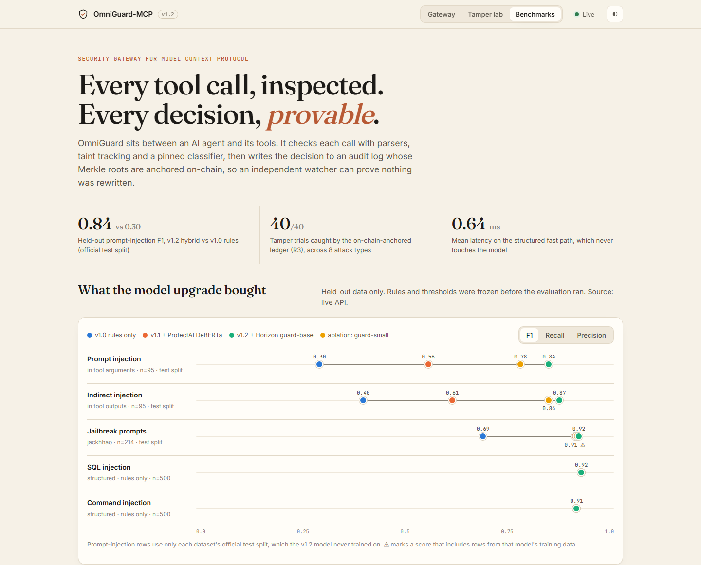

# OmniGuard-MCP

**Every tool call, inspected. Every decision, provable.**
A security gateway for Model Context Protocol (MCP) agents. It pairs a deterministic + integrity-pinned ML inspection engine with an audit log whose Merkle roots are anchored on-chain, and an independent watcher that proves the log was not rewritten.


[](https://omniguard-mcp.vercel.app)
[](https://omniguard-mcp-api.onrender.com/api/health)

**▶ [Try it live](https://omniguard-mcp.vercel.app)** · **🎬 [Watch the 2-minute launch film](https://github.com/lucky07-07/omniguard-mcp/releases/download/v1.2-horizon-guard/omniguard_launch_film.mp4)** · [API health](https://omniguard-mcp-api.onrender.com/api/health)

The live API runs on Render's free tier, which sleeps when idle, so the first request can take 30–60 s. The dashboard shows a "Waking server" indicator meanwhile.



| Key result (held-out data, thresholds frozen first) | v1.0 rules | v1.1 hybrid | **v1.2 hybrid** |
|---|---|---|---|
| Prompt injection in tool **arguments**, F1 (official test split, n = 95) | 0.295 | 0.556 | **0.844** (P 1.000 · R 0.731) |
| Indirect injection in tool **outputs**, F1 (official test split, n = 95) | 0.400 | 0.613 | **0.870** (P 1.000 · R 0.769) |
| SQL / command injection F1 (structured, never routed to the model) | 0.922 / 0.911 | same | same |
| Tamper trials caught (8 attack types × 5 trials): R1 / R2 / **R3** | | | 10/40 · 20/40 · **40/40** |
| Structured fast path (R1), mean / p95 | | | **0.64 ms / 1.0 ms**, 0 of 500 calls routed to the model |
| Free-text hybrid path on an RTX 2060, mean / p95 | | | 19.5 ms / 32.8 ms (≈ 18 ms of ONNX inference) |

> **Scope.** The hybrid stage narrows the semantic prompt-injection gap; it does not close it. About a quarter of paraphrased injections in the held-out test split still pass, and they are listed in [`results/external_dataset_eval.md`](results/external_dataset_eval.md). Containment (taint-based egress blocking, ABAC) is the backstop. See [docs/THREAT_MODEL.md](docs/THREAT_MODEL.md).

---

## What it does

```
        AI agent (MCP client)
              |  JSON-RPC over stdio or HTTP  (bearer token)
              v
 +-------------------------------------------------------------------+
 | Agent 1  gateway_agent.py                                          |
 |  identity -> tool SHA-256 pin -> ABAC -> ingress engine            |
 |  -> downstream call + taint update -> egress engine / DLP -> audit |
 |  ingress/egress = canonicalize -> parsers + signatures             |
 |                   -> (prose only) pinned ONNX classifier, 2-tier   |
 +---------------------+---------------------------+-----------------+
                       v                           v
 +---------------------------------+   +------------------------------+
 | Agent 2  audit_anchor_agent.py  |   | MCP tool server (reference:  |
 |  R1 plain | R2 hash chain |      |   | 10 tools, side effects       |
 |  R3 chain + Merkle(B=16) +       |   | simulated)                   |
 |     anchorBatch() on-chain       |   +------------------------------+
 +---------------+-----------------+
                 v
        AuditAnchor.sol (write-once)  <-- own RPC --  Agent 3  watcher_agent.py
                                                      separate process, SQLite mode=ro,
                                                      own tool + model manifest snapshots
```

| Layer | What it does |
|---|---|
| **Canonicalizer** | Decodes URL, Base64, hex, `\x`, HTML entities and Unicode tricks to a fixed point. Every later stage sees the decoded payload, and so does the classifier. |
| **Structural analyzers** | Path jail; SSRF checks (`ipaddress`, including decimal, hex, octal and IPv4-mapped IPs, plus the metadata address); quote-aware shell lexer; SQL lexer with libinjection-style quote-breakout contexts. v1.2 adds hard rules for chat-template escapes (`<\|im_start\|>`, `<\|endoftext\|>`, `[INST]`, `<<SYS>>`) and for hidden HTML/Markdown comments that address an AI. |
| **Taint tracking** | Labels only ever accumulate (`CLEAN` → `TAINTED_UNTRUSTED` / `TAINTED_SENSITIVE`). A session that has read sensitive data can never call `http_post` / `send_email` / `webhook_emit`. |
| **Entropy DLP** | Prefixed secrets (AWS, GitHub, `sk-`, PEM, JWT …) are checked against Shannon entropy and `REDACT`ed in tool outputs. |
| **Hybrid ML (v1.2)** | [`Horizon-Labs/prompt-injection-guard-base`](https://huggingface.co/Horizon-Labs/prompt-injection-guard-base) (Apache-2.0, multilingual mmBERT), served by ONNX Runtime on CUDA with CPU fallback. It only sees canonicalized prose that already passed every deterministic check. **Two-tier cascade:** τ_clean = 0.26 for clean sessions where no rule fired; τ_elevated = 0.19 for untrusted content or after any rule hit. |
| **Model pinning** | `model.onnx` + `tokenizer.json` are SHA-256-pinned in `configs/model_manifest.json` and verified in memory with `hmac.compare_digest`. The session is built from those same bytes. A tampered model is refused (fail closed), and offline tampering is caught by the watcher. |
| **ABAC** | Deny-by-default role → tool → parameter policy. Example: an `analyst` may run only `SELECT`, with `LIMIT ≤ 100`, on allowlisted tables. |
| **Audit regimes** | R1 plain table · R2 SHA-256 hash chain · R3 hash chain + Merkle batches anchored on [`AuditAnchor.sol`](contracts/AuditAnchor.sol). Every record carries `inspection_path`, `ml_score_milli`, the execution provider and `model_sha16`. |

## Evaluation protocol (zero leakage)

1. **Split.** Rows of each Hugging Face dataset (streamed) are split by `sha256(text) % 5` into a 20% *dev* and an 80% *eval* partition. The split has been the same since v1.0.
2. **Rules.** Deterministic rules were written on dev only and frozen.
3. **Training-data overlap.** The Horizon models were trained on the deepset and jackhhao **train** splits (per the model card). So both the ML calibration and the headline numbers use only each dataset's official **test** split. The full-partition view is also reported, with overlapping rows counted and flagged ⚠.
4. **Thresholds.** The cascade thresholds were swept over τ ∈ [0.15, 0.55] on the *validation* set (dev ∩ test split, 86 rows) for the best F1, then frozen ([`results/ml_calibration.json`](results/ml_calibration.json)). Pairs within 0.005 F1 of the best (about one example) count as ties, broken towards higher precision.
5. **Eval run.** v1.0, v1.1, v1.2 and a guard-small ablation are scored on the eval partition, and every engine sees the same rows. As a sanity check, v1.0 and v1.1 reproduce their earlier published numbers exactly.

Full tables: [`results/SUMMARY.md`](results/SUMMARY.md) · [`results/external_dataset_eval.md`](results/external_dataset_eval.md) · [`results/tamper_detection_r1_r2_r3.md`](results/tamper_detection_r1_r2_r3.md) · [`results/performance_storage_r1_r2_r3.md`](results/performance_storage_r1_r2_r3.md)


| Tamper scenario | R1 | R2 | R3 |
|---|---|---|---|
| S1 edit a record (DENY→ALLOW) | – | ✓ | ✓ |
| S2 delete a record | ✓¹ | ✓ | ✓ |
| S3 roll back the newest batch | – | – | ✓ |
| S4 reorder / swap payloads | – | ✓ | ✓ |
| S5 edit + recompute chain and local Merkle roots | – | – | ✓ |
| S6a tool rug-pull (pins intact) | ✓² | ✓² | ✓² |
| S6b tool rug-pull + gateway pins rewritten | – | – | ✓ |
| S7 model/tokenizer tampering + model manifest rewritten | – | – | ✓ |

¹ Caught via the autoincrement id gap. ² Caught by the gateway's pin check. Each scenario has 5 randomized trials, run by a separate watcher process, with zero false alarms on clean logs.

---

## Quick start

```powershell
python -m venv .venv
.\.venv\Scripts\python -m pip install -e ".[dev]"
.\.venv\Scripts\python scripts\fetch_model.py
```

`fetch_model.py` downloads each model at a pinned Hugging Face revision into `models/` (git-ignored) and verifies it against `configs/model_manifest.json`; it exits non-zero on any mismatch.

* `--model all` also fetches the v1.1 baseline and the guard-small ablation.
* `onnxruntime-gpu[cuda,cudnn]` ships its own CUDA/cuDNN runtime wheels, so you only need an NVIDIA driver.
* Without a GPU it runs on CPU (`OMNIGUARD_FORCE_CPU=1` forces this).
* Without the model files the gateway runs deterministic-only (`OMNIGUARD_DISABLE_ML=1` simulates that).

```powershell
.\.venv\Scripts\python -m pytest -q
```

```powershell
.\.venv\Scripts\python scripts\run_all_experiments.py
```

The test suite passes in all three modes: GPU, CPU-only, and no model installed. `run_all_experiments.py` re-runs the evaluation, tamper and latency experiments, then refreshes `results/` and the dashboard snapshot `frontend/metrics.json`. It does **not** re-calibrate thresholds; that is a separate, one-time step: `python -m omniguard.evaluation.calibrate_ml --write`.

## Live demo: Render API + Vercel dashboard

**Backend:** [`omniguard/api/server.py`](omniguard/api/server.py), FastAPI. It runs the real deterministic engine, the R1/R2/R3 ledgers, `AuditAnchor.sol` on an embedded EVM, and the watcher. The ONNX stage is off there, to fit Render's 512 MB free tier; measured at about 114 MB RSS.

| Endpoint | Purpose |
|---|---|
| `GET /api/health` | contract address, block number, anchored batch count |
| `POST /api/gateway/call` | `{role, tool, arguments, session_id, taint_override, simulate_rugpull}` → stage-by-stage trace, entry hashes, anchor receipt |
| `GET /api/ledger` | R1/R2/R3 rows, Merkle batches, on-chain roots and transactions |
| `POST /api/tamper/{edit_decision\|delete_row\|rewrite_chain\|truncate_tail\|tool_rugpull}` | real SQLite tampering on the live ledger |
| `POST /api/watcher/verify` | read-only watcher sweep over all three regimes |
| `POST /api/ledger/reset` | fresh, anchored baseline |
| `GET /api/metrics` | benchmark summary from `results/` |

**Live now:** dashboard at [omniguard-mcp.vercel.app](https://omniguard-mcp.vercel.app), API at [omniguard-mcp-api.onrender.com](https://omniguard-mcp-api.onrender.com/api/health).

**Deploy the backend:** in Render, choose *New → Blueprint* and select this repo. [`render.yaml`](render.yaml) installs `requirements-render.txt` (no onnxruntime, torch or datasets) and starts `uvicorn omniguard.api.server:app` with `/api/health` as the health check.

**Deploy the frontend:** import the repo in Vercel. [`vercel.json`](vercel.json) serves `frontend/` as a static site, and `.vercelignore` keeps the backend out of the upload.

**Dashboard API selection:** the dashboard calls `https://omniguard-mcp-api.onrender.com` by default and falls back to `http://localhost:8000` when it is served locally; `?api=<url>` overrides both. If the API is asleep, the benchmark tab still loads from the committed `frontend/metrics.json`.

**Run it locally:**

```powershell
.\.venv\Scripts\python -m uvicorn omniguard.api.server:app --port 8000
```

```powershell
.\.venv\Scripts\python -m http.server 5173 --directory frontend
```

## Launch film

**[Watch it](https://github.com/lucky07-07/omniguard-mcp/releases/download/v1.2-horizon-guard/omniguard_launch_film.mp4)** (1:57, 1080p). Every UI shot in it is a real screenshot of the deployed dashboard and API, taken during real gateway calls, a real tamper attack and a real watcher sweep. [`film_capture.py`](docs/demo/film_capture.py) drives the live site with Playwright, and [`film_compose.py`](docs/demo/film_compose.py) adds the eased push-ins, captions and the sound bed under the voiceover.

[`docs/demo/LAUNCH_SCRIPT.md`](docs/demo/LAUNCH_SCRIPT.md) is a 1:57 shot-by-shot storyboard. It has timestamped visuals, kinetic text, voiceover and sound cues, and a fact sheet tracing every number to `results/`. [`docs/demo/make_voiceover.py`](docs/demo/make_voiceover.py) renders the voiceover with Gnani Timbre: the key comes from `GNANI_API_KEY` or `--key-file`, and the audio goes to the git-ignored `demo_media/`.

## Run the system yourself

The identities in `configs/abac_policies.yaml` are local development test identities (tokens `dev-token-<role>`; only their hashes are stored). Replace them before real use.

```powershell
.\.venv\Scripts\python -m omniguard.crypto.chain_node --port 8545
```

```powershell
.\.venv\Scripts\python -m omniguard.agents.gateway_agent --transport http --port 8765 --regime R3 --rpc-url http://127.0.0.1:8545 --engine hybrid
```

```powershell
.\.venv\Scripts\python -m omniguard.agents.watcher_agent --db results/runtime/gateway_audit.db --regime R3 --deployment results/runtime/deployment.json --manifest-snapshot configs/pinned_tools.json --model-manifest-snapshot configs/model_manifest.json --model-dir models/horizon-guard-base --live-sample-server --json
```

## Repository layout

```
configs/      abac_policies.yaml, security_rules.yaml (rules, cascade thresholds), pinned_tools.json,
              model_manifest.json (model + tokenizer SHA-256 pins), legacy/ (frozen v1.0 / v1.1 rule sets)
contracts/    AuditAnchor.sol (+ compiled artifact)
frontend/     index.html (dashboard), metrics.json (static benchmark snapshot)
omniguard/
  api/        server.py (FastAPI live demo), metrics.py
  agents/     gateway_agent, audit_anchor_agent, watcher_agent
  crypto/     hashing, merkle, blockchain, chain_node
  security/   canonicalizer, analyzers, taint_tracker, abac, tool_integrity, ml_classifier, security_engine
  storage/    audit_store (R1/R2/R3, read-only access)
  tools/      sample_mcp_server (all side effects simulated)
  evaluation/ external_dataset_eval, calibrate_ml, tamper_experiments, perf_benchmark, workload
scripts/      run_all_experiments.py, fetch_model.py
docs/         THREAT_MODEL.md, demo/ (launch script, voiceover), img/
tests/        9 test modules
render.yaml · requirements-render.txt · vercel.json
```

## Versions

| Tag | Engine |
|---|---|
| `v1.0-deterministic-baseline` | rules only |
| `v1.1-hybrid-ml` | rules + ProtectAI DeBERTa v2 (thresholds 0.896 / 0.328) |
| `v1.2-horizon-guard` | rules + Horizon guard-base, canonicalized input, two-tier cascade, template/comment rules, live API + dashboard |
